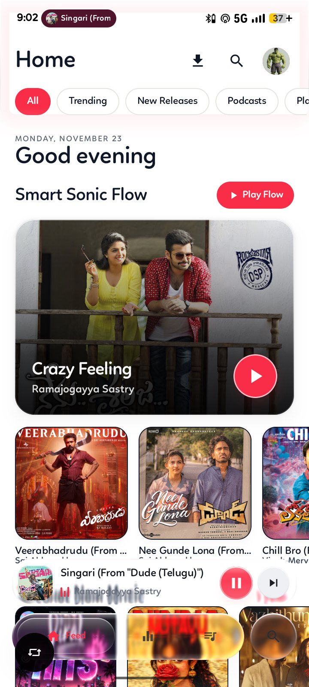
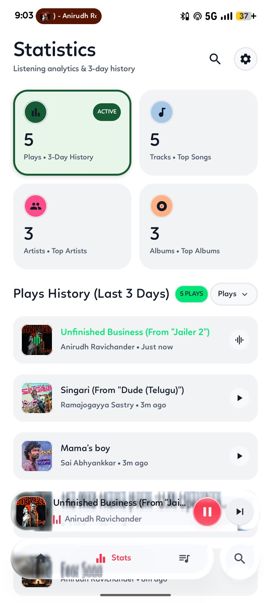
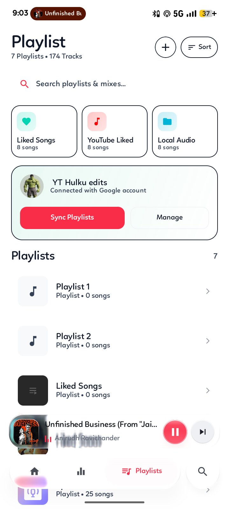
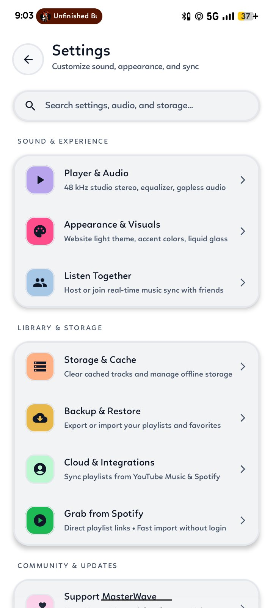

# MasterWave

[](https://masterwave.vercel.app)
[-green?style=flat-square)](https://developer.android.com)
[](https://kotlinlang.org)
[](https://developer.android.com/jetpack/compose)
[](https://developer.android.com/media/media3)
[](LICENSE)

MasterWave is a native Android music player and streaming client engineered with Jetpack Compose, Material 3, and AndroidX Media3. Built with a focus on studio-grade audio output, real-time WebRTC collaborative listening, tactile liquid glass UI, and zero ads or trackers.

- **Website**: [https://masterwave.vercel.app](https://masterwave.vercel.app)
- **Direct APK**: [Download Latest v2.2.3 APK](https://masterwave.vercel.app/assets/MasterWave.apk)
- **Web App**: [https://masterwave-music.vercel.app](https://masterwave-music.vercel.app)

---

## Interface

| Home Feed | Listening Analytics | Playlists & Sync | Studio Settings |
|:---:|:---:|:---:|:---:|
|  |  |  |  |
| Smart Sonic Flow & Feed | 3-Day History & Insights | Google Account & Local Sync | Audio Engine & Spotify Grab |

---

## Highlights

### Audio Architecture
- **Low-Latency Pipeline**: Direct 48 kHz / 24-bit PCM rendering pipeline via AndroidX Media3 ExoPlayer.
- **Surgical Equalizer**: Hardware-accelerated 10-band parametric EQ, bass boost, dynamic loudness enhancer, and custom audio presets.
- **Persistent Artwork Cache**: Embedded ID3 tag art extraction with internal companion thumbnail cache for seamless offline playback.
- **Gapless & ReplayGain**: Instant audio buffer switching and dynamic volume normalization.

### Design & Interaction
- **Liquid Glass Shell**: Custom `RuntimeShader` (AGSL) glass refraction on Android 13+ with organic fallback down to Android 8.0.
- **Fucek Typography**: High-contrast geometric display typography applied across all interface components.
- **Kinetic Album Canvas**: Dynamic ambient breathing and micro-rotation synchronized with playback states.
- **Adaptive Dock Navigation**: Floating liquid glass navigation shelf that minimizes seamlessly during feed interaction.

### Realtime & Library Synchronization
- **Listen Together**: Peer-to-peer audio synchronization over WebRTC with alphanumeric room codes (`MW7411`).
- **Synced Lyrics**: Sub-second synchronized scrolling lyrics powered by LRCLIB with manual offset adjustment.
- **Cross-Platform Sync**: YouTube Music and Spotify playlist import with zero audio substitution.
- **In-App Self-Update**: Silent PackageInstaller update lifecycle on Android 12+ (`USER_ACTION_NOT_REQUIRED`) with pre-install cryptographic signature verification.

---

## Technical Stack

| Layer | Component |
|---|---|
| **Language** | Kotlin 2.0.21 |
| **UI Toolkit** | Jetpack Compose (BOM 2024.10.01) + Material 3 |
| **Audio Core** | AndroidX Media3 (ExoPlayer 1.4.1, Session, UI) |
| **Concurrency** | Kotlin Coroutines & Reactive StateFlow / SharedFlow |
| **Network & Sync** | OkHttp 4.12.0, WebSockets, WebRTC (Google WebRTC Android SDK) |
| **Graphics & Shaders** | AGSL (Android Graphics Shading Language), RenderEffect, Canvas |
| **Image Loading** | Coil 2.7.0 (Custom disk caching & bitmap transformation) |
| **Persistence** | Jetpack DataStore & Encrypted SharedPreferences |

---

## Repository Structure

```
MasterWave/
├── app/
│   ├── src/main/
│   │   ├── java/com/masterwave/player/
│   │   │   ├── data/             # Audio repository, updates, cache, WebRTC
│   │   │   │   ├── model/        # Track, Playlist, Album, Lyric data contracts
│   │   │   │   ├── update/       # AppUpdateManager, PackageInstaller receivers
│   │   │   │   └── webrtc/       # Peer-to-peer room sync & audio state broadcast
│   │   │   ├── service/          # MediaSessionService & MasterWavePlaybackService
│   │   │   └── ui/               # Jetpack Compose UI
│   │   │       ├── components/   # LiquidGlass, MiniPlayerDock, FloatingNavigationDock
│   │   │       ├── screens/      # HomeScreen, NowPlaying, ListenTogether, Appearance
│   │   │       └── theme/        # Color schemes, Type scales, ThemeState, Fucek font
│   │   ├── res/                  # Vector drawables, Fucek typography, XML configs
│   │   └── AndroidManifest.xml   # Foreground media playback & install permissions
├── build.gradle.kts              # Root build configuration
└── settings.gradle.kts           # Module & repository declarations
```

---

## Building from Source

### Prerequisites
- **JDK**: Java 17 or higher
- **Android SDK**: `compileSdk 36`, `minSdk 26`, `targetSdk 35`
- **Gradle**: 8.7+ (wrapper included)

### Clone & Build

```bash
# Clone the repository
git clone https://github.com/maheshbuilds-dev/MasterWave.git
cd MasterWave

# Build debug APK
./gradlew assembleDebug

# Build optimized release APK
./gradlew assembleRelease
```

The compiled binary will be located at:
`app/build/outputs/apk/release/app-release.apk`

---

## Security & Privacy
- **Zero Telemetry**: No third-party tracking, analytics, or behavioral telemetry.
- **Network Security**: Strict HTTPS enforcement via Android Network Security Config.
- **Cryptographic Package Verification**: In-app update downloads are cryptographically validated against the active signing certificate before invoking `PackageInstaller`.

---

## License

MasterWave is licensed under the [Apache License, Version 2.0](LICENSE).
