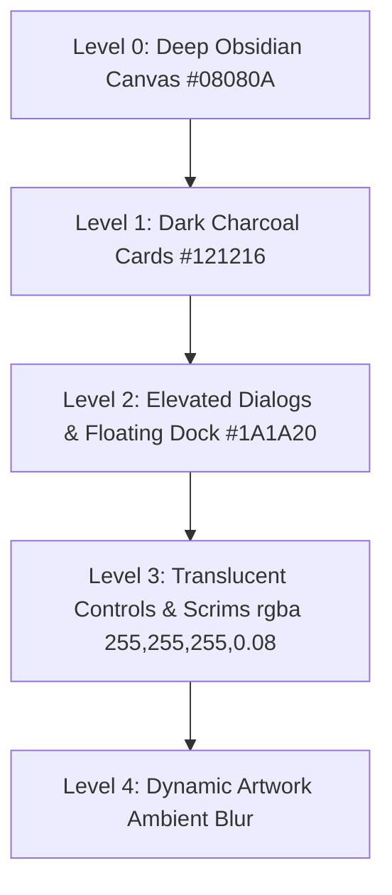

# MasterWave Design System: Obsidian & Crimson

**Design Version:** 1.0  
**Application:** MasterWave (`com.masterwave.player`)  
**Visual Philosophy:** Premium, cinematic, dark-mode first, content-dominant, high-contrast, tactile.

---

## 1. Design Principles

1. **Content is King:** Album artwork and music metadata take center stage. Surrounding UI elements serve to elevate and frame the music, never compete with it.
2. **Atmospheric Immersion:** Dual-layer blurred ambient glow derived dynamically from the dominant colors of the active album art.
3. **Ergonomic One-Handed Control:** Critical playback actions (Play/Pause, Skip, Seek, Queue gesture) are reachable within the natural thumb sweep on a 6.5-inch 20:9 display (such as the Moto G45).
4. **Motion with Intent (120 Hz):** Physics-based spring curves for gesture dismissals, sheet expansions, and progress dragging. No sluggish linear animations.
5. **Legibility & Contrast:** Crisp typographic hierarchy utilizing tabular figures for timecodes, bold high-contrast titles, and subtle muted secondary information conforming to WCAG 2.1 AAA contrast on dark backgrounds.

---

## 2. Spatial Grid & Layout Architecture

- **Base Grid:** 8dp spatial grid with 4dp micro-increments.
- **Screen Margins:**
  - Phone Portrait: 16dp horizontal padding (20dp for primary hero cards).
  - Tablet / Landscape: Centered max-width constraints (600dp for Now Playing controls, 840dp for tracklists).
- **Corner Radii:**
  - Standard Cards: 16dp
  - Hero Artwork: 20dp
  - Mini-Player Floating Dock: 24dp
  - Transport Buttons / Chips: Fully rounded pills (50%)
  - Dialogs & Sheets: 28dp top corners

---

## 3. Surface & Scrim Elevations

MasterWave avoids stark shadows, using tonal elevation and translucent material blurring (Liquid Glass / Frosted Scrims) instead:

